## Task 1

После сканирования nmap обнаружены:
- FTP (порт 21) — сервис vsftpd версии 2.3.4.
- SSH (порт 22) — сервис OpenSSH версии 4.7p1.
- Telnet (порт 23) — протокол удаленного доступа.
- SMTP (порт 25) — почтовый сервер Postfix.
- HTTP (порт 80) — веб-сервер Apache версии 2.2.8.
- Samba (порты 139, 445) — служба для общего доступа к файлам (SMB).

и другие сервисы.

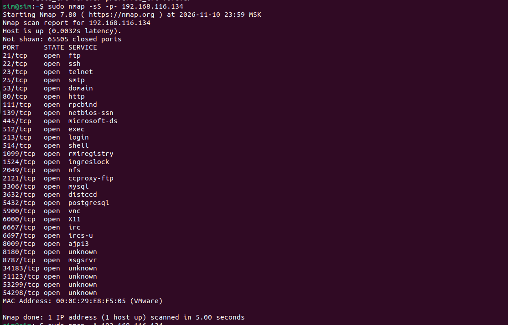
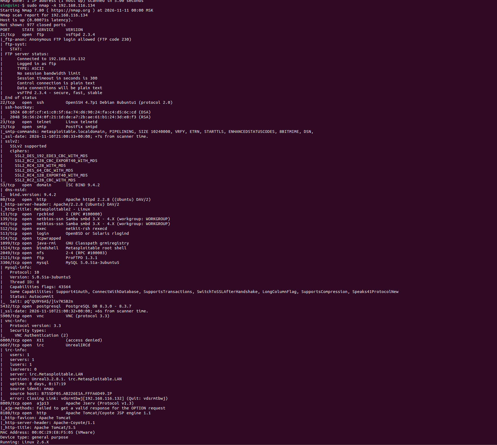
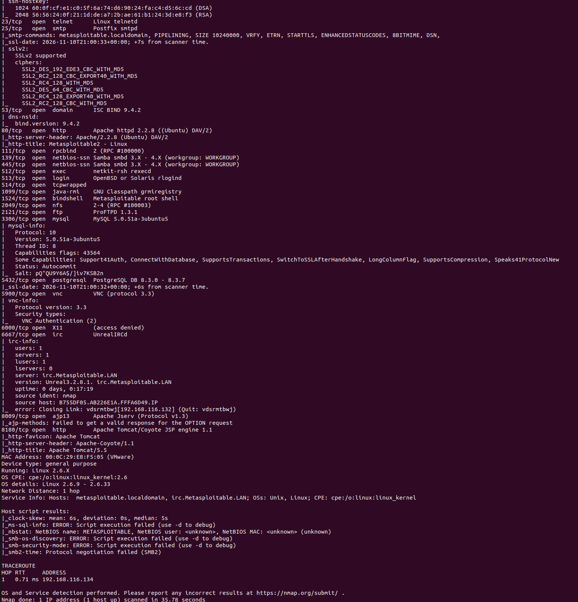

[vsftpd 2.3.4 - Backdoor Command Execution](https://www.exploit-db.com/exploits/17491)

[Samba 3.0.20 < 3.0.25rc3 - 'Username' map script' Command Execution](https://www.exploit-db.com/exploits/16320)

[UnrealIRCd 3.2.8.1 - Remote Downloader/Execute ](https://www.exploit-db.com/exploits/13853)

## Task 2

- Если порт открыт: Сервер отвечает пакетом SYN-ACK, nmap отправляет ему RST.
- Если порт закрыт: Сервер присылает пакет RST.

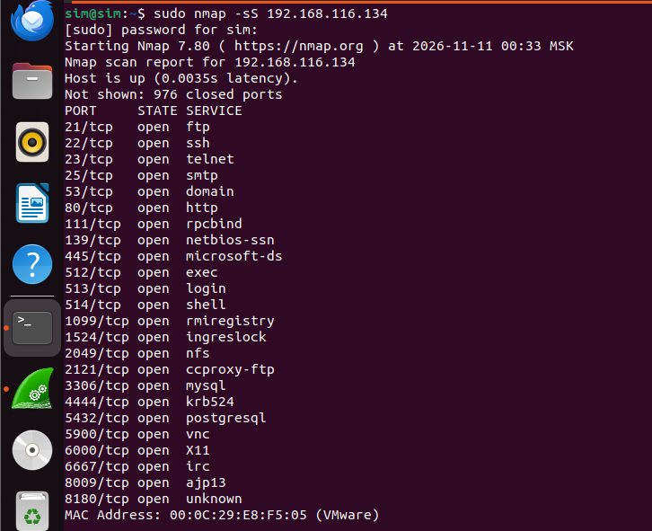

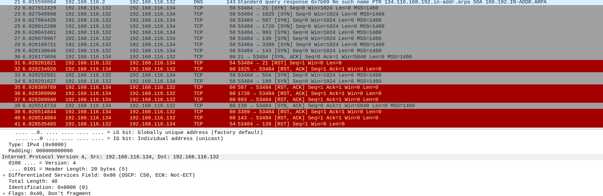

FIN
- Если порт открыт: Сервер по стандарту RFC 793 ничего не отвечает.
- Если порт закрыт: Сервер возвращает пакет RST

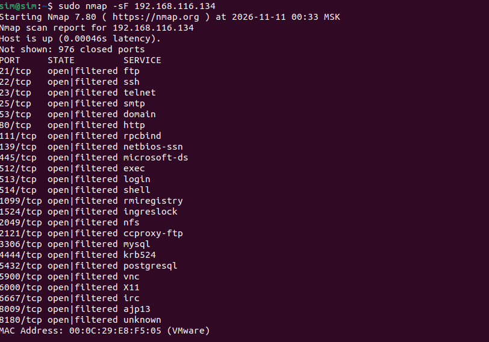

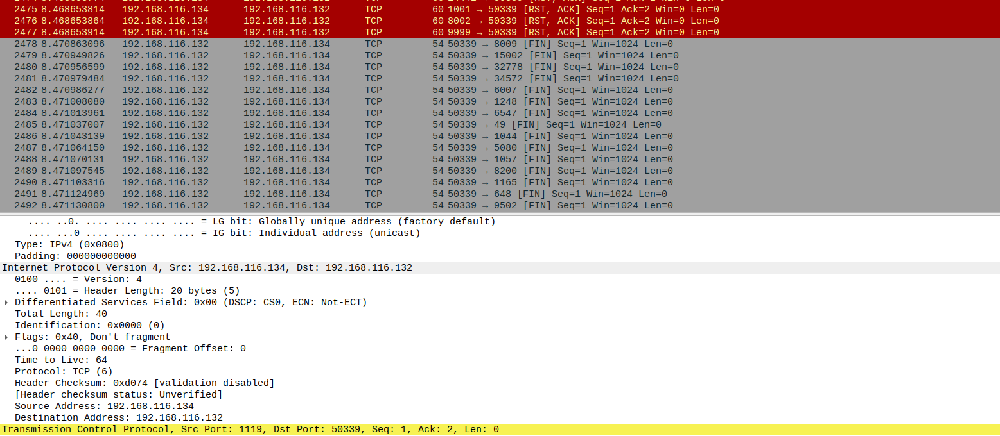

XMAS
- Если порт открыт: Сервер молчит.
- Если порт закрыт: Сервер присылает  RST

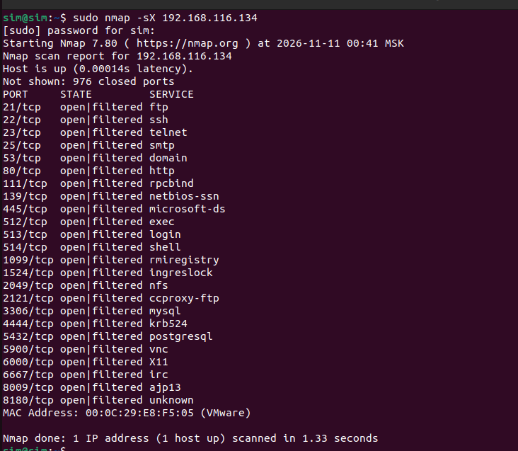

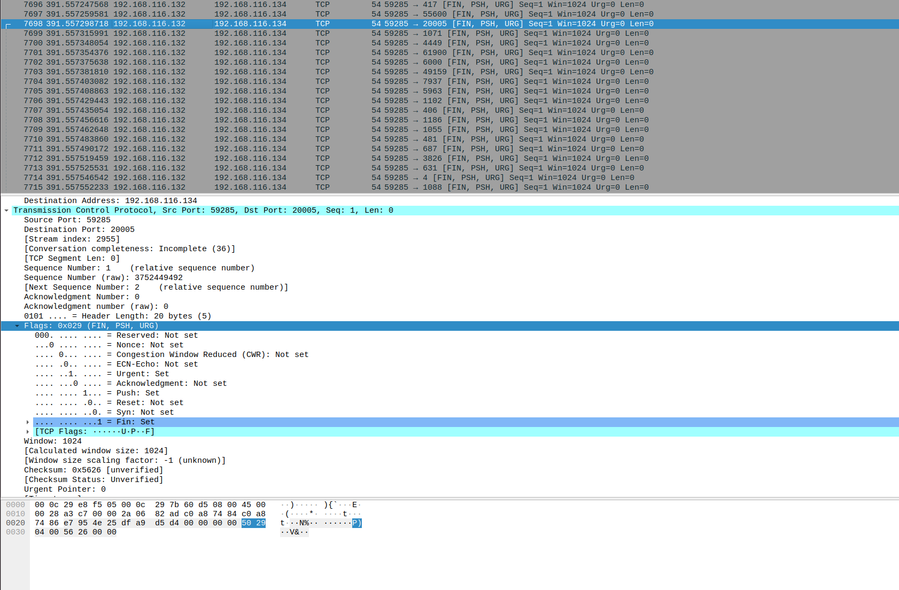

UDP

- Если порт открыт: Сервер либо молчит(TCP), либо присылает ответный UDP-пакет от этой службы (например,DNS или NetBios).
- Если порт закрыт: Маршрутизатор или сам сервер возвращает сетевую ошибку - Destination unreachable (Port unreachable).

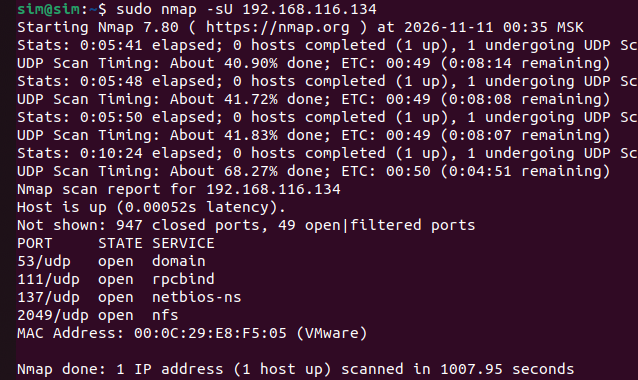

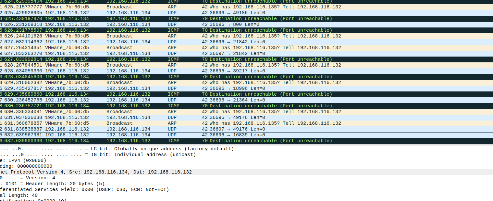