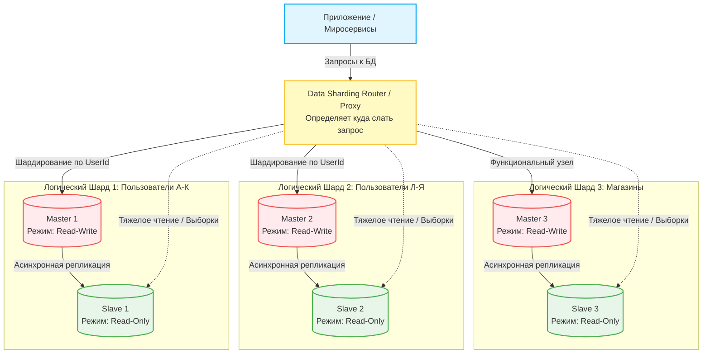

## Task 1

Схема с активным мастером и пассивным слейвом (Master-Standby)
Здесь главная фишка в подстраховке на случай, если всё упадет. У нас есть один главный сервер, куда идет вся работа, и второй, который просто молча копирует данные и ждет своего часа.
• Плюсы:
	1. Если главный сервер сломается, можно быстро переключить проект на запасной, и сайт не будет лежать часами.
	2. На пассивный сервер можно повесить создание бэкапов. База при этом не будет тормозить для обычных пользователей, потому что вся тяжелая нагрузка по копированию уйдет на вторую машину.

Схема с мастером и несколькими слейвами (Read-Scaling)
Этот вариант уже про то, как разгрузить базу, если на сайт заходит очень много людей. Пишем мы всё так же на один мастер-сервер, а вот читают данные (смотрят товары, ищут инфу) люди уже с копий.
• Плюсы:
	1. База перестает тупить, когда куча пользователей одновременно что-то ищет на сайте. Запросы просто раскидываются по разным слейв-серверам.
	2. Очень удобно для аналитики. Можно выделить один отдельный слейв для подразделения и на скорость работы самого сайта для клиентов это вообще никак не повлияет.

---

## Task 2

План шардирования базы данных

1. По вертикали (разносим таблицы): Таблицу stores убираем на отдельный сервер. Вряд ли будет много записей, данные там меняются редко, и дергать их вместе с пользователями нет смысла.
2. По горизонтали (пилим таблицы на куски): users и books станет со временем слишком много, в один сервер они нормально не влезут, поэтому мы делим их пополам. 

• Master — работают в режиме чтения и записи. Сюда приложение шлет всё, что меняет базу: регистрации новых юзеров, добавление книг, новые заказы.

• Slave — работают только на чтение. Они просто подтягивают изменения с мастеров и отдают данные, когда пользователю нужно что-то показать на экране.

