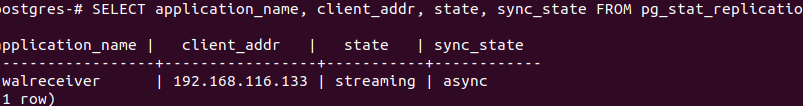
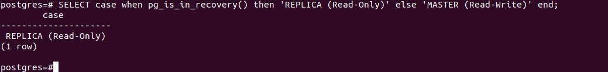
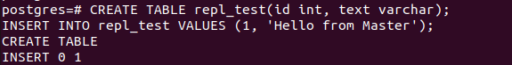
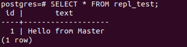

## Task 1

| Критерий | Master-Slave (Основной — Ведомый) | Master-Master (Мультимастер) |
| :--- | :--- | :--- |
| **Запись** | **Только на Master**. На Slave изменять данные напрямую нельзя — они прилетят туда только в виде копии с мастера. | **На любой из серверов**. Оба узла равноправны и принимают любые `INSERT / UPDATE / DELETE` запросы от приложения. |
| **Чтение** | С любого сервера (часто чтение распределяют на Slave, чтобы разгрузить Master). | С любого сервера. |
| **Отказ узда** | Если упадет Slave — проект работает. Если упадет Master — запись заблокируется, пока Slave руками или автоматикой не сделают новым Мастером. | Если упадет один Master, приложение просто переключит весь трафик (и чтение, и запись) на второй работающий Master. Простоя нет. |

## Task 2

---

---

На мастере добавляем запись

На слейве читаем

